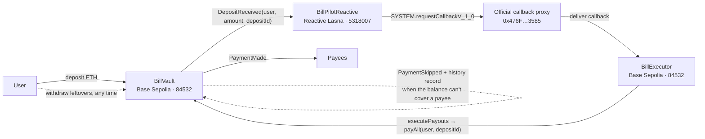

# BillPilot · Set-It-and-Forget-It Bill Autopay

**Register your fixed payees once. Every time money lands in your vault, the chain pays your bills for you, automatically, in seconds, with a full on-chain receipt. No bots, no keepers, no server to keep alive.**

Built for the **Reactive Omni Buildathon** (DoraHacks), track **Set It and Forget It**.
Testnet only: **Base Sepolia** (origin + destination) and **Reactive Lasna** (reactive contract).

📺 **Live dashboard:** https://ajengayukusu.github.io/billpilot/, payees, vault balance, and payment history read live from Base Sepolia, plus the proven end-to-end loops with explorer links for every hop.

🎬 **Demo video (2:34):** https://www.youtube.com/watch?v=75EkB2bvD7s · *BillPilot · Set It and Forget It: Automatic Bill Payments on Reactive Network*. A real screen recording of the live dashboard and the Loop 3 transactions on Basescan and Reactscan, with English narration.
🎬 **Update video · Loops 4–5 (1:09):** https://www.youtube.com/watch?v=UayoRTZyr7s · *BillPilot · Update: Loops 4 & 5 (Live Proof)*. Post-submission live proof, recorded from the live dashboard and the explorers: the insufficient-funds PaymentSkipped path (Loop 4) and payee flexibility, a payee added and an amount changed (Loop 5).

---

## The problem

Payday arrives, and then the manual ritual begins: rent for the boarding house (*kos*), the streaming subscription, the installment, each paid one by one, each easy to forget, each late payment punished with a fee. Existing "autopay" answers all need something babysat: a bank mandate you can't program, a keeper bot you must keep funded and online, or a cron server that is a single point of failure.

## The solution

BillPilot moves the ritual into the chain itself:

1. **Set it**, you register a fixed list of payees once (`setPayees`: wallet + fixed amount + label, up to 10).
2. **Fund it**, you `deposit()` ETH into BillVault whenever money comes in. That single call is the *only* thing you ever do again.
3. **Forget it**, a reactive contract on Reactive Lasna is subscribed to the vault's `DepositReceived` event. It reacts on-chain and requests a callback; BillExecutor on Base Sepolia runs the payout batch. Every payee whose fixed amount fits your remaining balance gets paid; a payee that doesn't fit is **skipped and recorded on-chain** (`PaymentSkipped`) instead of failing the whole batch. Leftovers stay in the vault, withdrawable any time.

## Architecture



### How Reactive Omni is used here

- **Omni pattern, not legacy.** Lasna migrated to the Omni fork (Oct 2026): there is no RVM and no `vm` flag. `BillPilotReactive` extends `AbstractReactive` from `reactive-lib-omni` **v0.1.0**, talks to the system contract at `0x8888888888888888888888888888888888888888` (`SYSTEM`), and guards `react()` with `onlySystem`.
- **Subscription** happens in the reactive contract's constructor: `SYSTEM.subscribe(84532, <BillVault>, topic0(DepositReceived(address,uint256,uint256)), REACTIVE_IGNORE, REACTIVE_IGNORE, REACTIVE_IGNORE)`.
- **Callback** uses the current API, `SYSTEM.requestCallbackV_1_0(...)` with a 1,000,000 gas limit, *not* the deprecated `Callback` event. The first payload argument is the reserved sender slot: the reactive contract passes `address(0)` and the network overwrites it with the reactive contract's address, which `BillExecutor` authenticates with `onlyCallbackSender`.
- **The reactive contract does real work**: it validates chain/contract/topic, decodes the depositor from `topic1` and `(amount, depositId)` from the log data, and routes the payout. Filtering is done by silently returning, never reverting (a revert in `react()` is still billed).
- **Debt discipline**: both the reactive contract (lREACT, Lasna) and the callback receiver (ETH, Base Sepolia) are pre-funded via `depositTo(...)`. Any outstanding debt silently stops delivery in the Reactive Network, so debt is checked after every loop, it was **0 on both sides after all six live loops (seven network callbacks)**.

## Contracts

| Contract | Chain | Address | Sourcify |
|---|---|---|---|
| BillVault | Base Sepolia (84532) | [`0x05Abd6e0a636B4D5ACB98540dc6b1f23D71F57b3`](https://sepolia.basescan.org/address/0x05Abd6e0a636B4D5ACB98540dc6b1f23D71F57b3) | [exact match](https://repo.sourcify.dev/contracts/full_match/84532/0x05Abd6e0a636B4D5ACB98540dc6b1f23D71F57b3/) |
| BillPilotReactive | Reactive Lasna (5318007) | [`0x35e3D4cdCd2EdFF55cDeb0c0710A8bF45e126871`](https://lasna.reactscan.net/address/0x35e3D4cdCd2EdFF55cDeb0c0710A8bF45e126871) | [exact match](https://repo.sourcify.dev/contracts/full_match/5318007/0x35e3D4cdCd2EdFF55cDeb0c0710A8bF45e126871/) |
| BillExecutor | Base Sepolia (84532) | [`0xFc2979342D96EeB950ba8246bCc8DF1868F3Df88`](https://sepolia.basescan.org/address/0xFc2979342D96EeB950ba8246bCc8DF1868F3Df88) | [exact match](https://repo.sourcify.dev/contracts/full_match/84532/0xFc2979342D96EeB950ba8246bCc8DF1868F3Df88/) |

- **BillVault** (no constructor args), origin + funds. Per-user payee registry (`setPayees` / `getPayees` / `payeeCount`, cap 10), `deposit()` emitting `DepositReceived`, `withdraw()` for leftovers, executor-only `payAll()` with skip-and-continue semantics and a full `PaymentRecord` history (`getHistory` / `historyCount`). All timing uses timestamps, never block counts (Base Sepolia blocks are 200 ms).
- **BillPilotReactive**, constructor `(address vault, address executor)`; deployed with `executor = address(0)` and wired afterwards via owner-only `setRecipient()` (the executor needs the reactive address as its immutable callback sender, so this order is forced).
- **BillExecutor**, constructor `(address callbackProxy, address reactiveContract, address vault)` with the official Base Sepolia callback proxy `0x476F44b11F5C942c58f4c8E3d0300E5710743585`.

Deployment transactions: Vault [`0xa14fff…3887`](https://sepolia.basescan.org/tx/0xa14fff7e1d0aa01207dab289cf24272e1b82153cc04b90c134293e2401be3887) · Reactive [`0xec29b5…ad0dc`](https://lasna.reactscan.net/tx/0xec29b536dfad2ed4e081ad52f6298b0c35b4407dee11f02eb8387ba150aad0dc) · Executor [`0x1dcc99…1d2f7`](https://sepolia.basescan.org/tx/0x1dcc9965e777c5723da416c8e04e40f7cc028721ad6b4aeadd2b747ee721d2f7). Full deployment record: [`deployment.json`](deployment.json).

## Proof · six full loops, live on testnet

In loops 1–3 the only transactions sent by the project wallet were the deposits (and, for loop 2, a `setPayees` update first), the reactive and callback transactions were produced by the Reactive Network itself, with **no human or bot in the middle**. Loops 4–5 were run **after the DoraHacks submission** as additional live demonstrations, wrapping the same untouched reactive path in owner-side `setPayees` / `withdraw` transactions to prove the paths loops 1–3 never exercised live: the insufficient-funds skip and `withdraw()` (loop 4), and payee-list flexibility, adding a payee and changing an amount (loop 5). Loop 6 goes further still: the deposit came from a **second, independent user wallet** with its own payee list, the same vault, reactive contract and executor paid it out with no configuration change, and the first user's payees, history and balance were left completely untouched. Loop 3 was run for the demo recording, watch it here: 🎬 https://www.youtube.com/watch?v=75EkB2bvD7s

### All loops at a glance

| Loop | Deposit (Base Sepolia) | Reactive (Lasna) | Callback (Base Sepolia) | Latency | Outcome |
|---|---|---|---|---|---|
| 1 | [`0xf9000609…be4f`](https://sepolia.basescan.org/tx/0xf9000609969f46b30ed777a7d8480814a8f07b6251bd068c26237f5a4964be4f) | [`0xf9057e08…c081`](https://lasna.reactscan.net/tx/0xf9057e084cace5328f8fde93251c2a14c6b82e197937cc1c0bcc6abf9f35c081) | [`0x58cd6b9a…2ae6`](https://sepolia.basescan.org/tx/0x58cd6b9a9720b89f62a2612da674056dd42fabdc74f75132f2e159ae34502ae6) | 1 s | 2 Paid, Kos 0.0006, Langganan 0.0004 |
| 2 | [`0xf9813aaf…b166`](https://sepolia.basescan.org/tx/0xf9813aafc4174daa545828300c44f3a5a3897853392c54916db295989861b166) | [`0xaa81edf6…9647`](https://lasna.reactscan.net/tx/0xaa81edf6d42c3d77e3e4a178d14f7ba1b068ac0352ac9394e8af8575df809647) | [`0x37fac4ed…56d6`](https://sepolia.basescan.org/tx/0x37fac4ed222ab967c70a2818ddd2a1878b3a3ce5bc9e55c6eda8ab04e9a356d6) | 3 s | 2 Paid, Kos 0.0003, Langganan 0.0002 (after re-set) |
| 3 | [`0x94adef28…200e`](https://sepolia.basescan.org/tx/0x94adef28319ad0d588399c375622ddbe9a4293f0f6bcb6882f11459a1ef8200e) | [`0x6255d076…6f6df`](https://lasna.reactscan.net/tx/0x6255d07673badabb5aa73f98c9500ff9549039b3173d2a1dfd417f2f07c6f6df) | [`0x7321ab10…b7bdc`](https://sepolia.basescan.org/tx/0x7321ab10c4df58d5b7c33861c3d2dea1f0e69df1d4ae7f955adb7fa9ac0b7bdc) | 1 s | 2 Paid, the demo-video loop |
| 4 | [`0xb5c928eb…69bb`](https://sepolia.basescan.org/tx/0xb5c928eba2734f66f0f34a1edbc288985079927a0502495172db6acd561169bb) | [`0x457bc158…4885`](https://lasna.reactscan.net/tx/0x457bc158ae60f0ab7ea8cb42d1d0ab7d803b2316690b622952f90853e9464885) | [`0xd4c7f97d…ad1`](https://sepolia.basescan.org/tx/0xd4c7f97d687f191c1210c77acfe860d72f519d3bbda9570bdb22ff812c889ad1) | 1 s | 1 Paid (Kos 0.0004) + **1 Skipped** (Langganan 0.0008); `withdraw()` ×2, 0.0009 + 0.0001 ETH |
| 5a | [`0x109072ad…ce8d`](https://sepolia.basescan.org/tx/0x109072adeeade37b7db85fcc4da78349b33a86e03db043ae2dd9560b7b63ce8d) | [`0x5172643b…8504`](https://lasna.reactscan.net/tx/0x5172643b187d7081496fd4e9d4b9ad29599452391d40b73818fb7727f8aa8504) | [`0x562b1c0b…7553`](https://sepolia.basescan.org/tx/0x562b1c0b49bfc6fcc5a3c3ab3afc5a93dc956ecb775cbfef4dc991f27d2f7553) | 1 s | **3 Paid**, third payee (Internet 0.00008) added and paid |
| 5b | [`0xb7d9e580…3447`](https://sepolia.basescan.org/tx/0xb7d9e5808c49111cd10c34ff8836ea3426f17c0ceb657d43ac8472d58f173447) | [`0xf1e42fc5…3d20`](https://lasna.reactscan.net/tx/0xf1e42fc57cd660bd7d792b628f629d8a01683b518153a3322c53bdfe88763d20) | [`0x89f1e42b…dea6`](https://sepolia.basescan.org/tx/0x89f1e42b02cdb5af247e3d63360cade977f18eb4bb06e1f29517c9bcad04dea6) | 2 s | 2 Paid, Langganan at the **new** 0.00015 amount + **1 Skipped** (Internet) |
| 6 | [`0x2ac94b1e…bb5a`](https://sepolia.basescan.org/tx/0x2ac94b1efefb8ff4a730fc9bfa87d6dcd8b0721cebb3bfa0799187fd2b5abb5a) | [`0xad716fc6…b823`](https://lasna.reactscan.net/tx/0xad716fc60bc69d74fe56b8975d08f618d01830bf9fac9eefa104288d39a9b823) | [`0x62192c0a…7913`](https://sepolia.basescan.org/tx/0x62192c0a02a7421d43d3f46e490ebd3dd6248babd6d12b589e15154eb7237913) | 1 s | 2 Paid, **second user**: Kos 0.0002, Internet 0.0001 |

### Loop 1 · deposit 0.0015 ETH (payees: Kos 0.0006, Langganan 0.0004)

| Hop | Transaction | Evidence |
|---|---|---|
| Deposit (Base Sepolia) | [`0xf9000609…be4f`](https://sepolia.basescan.org/tx/0xf9000609969f46b30ed777a7d8480814a8f07b6251bd068c26237f5a4964be4f) | `DepositReceived(user, 0.0015 ETH, depositId 1)` |
| Reactive (Lasna) | [`0xf9057e08…c081`](https://lasna.reactscan.net/tx/0xf9057e084cace5328f8fde93251c2a14c6b82e197937cc1c0bcc6abf9f35c081) | `CallbackRequested(user, 0.0015 ETH, 1, executor)` |
| Callback (Base Sepolia) | [`0x58cd6b9a…2ae6`](https://sepolia.basescan.org/tx/0x58cd6b9a9720b89f62a2612da674056dd42fabdc74f75132f2e159ae34502ae6) | `PayoutsExecuted` + 2× `PaymentMade` |

**End-to-end latency: 1 s** (block timestamps). Both payees paid in full; vault leftover 0.0005 ETH; debt 0 / 0 after.

### Loop 2 · deposit 0.001 ETH (payees re-set: Kos 0.0003, Langganan 0.0002)

| Hop | Transaction | Evidence |
|---|---|---|
| Deposit (Base Sepolia) | [`0xf9813aaf…b166`](https://sepolia.basescan.org/tx/0xf9813aafc4174daa545828300c44f3a5a3897853392c54916db295989861b166) | `DepositReceived(user, 0.001 ETH, depositId 2)` |
| Reactive (Lasna) | [`0xaa81edf6…9647`](https://lasna.reactscan.net/tx/0xaa81edf6d42c3d77e3e4a178d14f7ba1b068ac0352ac9394e8af8575df809647) | `CallbackRequested(user, 0.001 ETH, 2, executor)` |
| Callback (Base Sepolia) | [`0x37fac4ed…56d6`](https://sepolia.basescan.org/tx/0x37fac4ed222ab967c70a2818ddd2a1878b3a3ce5bc9e55c6eda8ab04e9a356d6) | `PayoutsExecuted` + 2× `PaymentMade` |

**End-to-end latency: 3 s** (block timestamps). Both payees paid in full (cumulative: Kos 0.0009 ETH, Langganan 0.0006 ETH); vault leftover 0.001 ETH; on-chain history holds 4 records, all `paid: true`; debt 0 / 0 after.

### Loop 3 · deposit 0.0004 ETH (payees unchanged: Kos 0.0003, Langganan 0.0002) · the demo-video loop

| Hop | Transaction | Evidence |
|---|---|---|
| Deposit (Base Sepolia) | [`0x94adef28…200e`](https://sepolia.basescan.org/tx/0x94adef28319ad0d588399c375622ddbe9a4293f0f6bcb6882f11459a1ef8200e) | `DepositReceived(user, 0.0004 ETH, depositId 3)` |
| Reactive (Lasna) | [`0x6255d076…6f6df`](https://lasna.reactscan.net/tx/0x6255d07673badabb5aa73f98c9500ff9549039b3173d2a1dfd417f2f07c6f6df) | `CallbackRequested(..., depositId 3, ...)` |
| Callback (Base Sepolia) | [`0x7321ab10…b7bdc`](https://sepolia.basescan.org/tx/0x7321ab10c4df58d5b7c33861c3d2dea1f0e69df1d4ae7f955adb7fa9ac0b7bdc) | `PayoutsExecuted` + 2× `PaymentMade` |

**End-to-end latency: 1 s** (block timestamps). Both payees paid again; vault leftover 0.0009 ETH; on-chain history holds 6 records, all `paid: true`; debt 0 / 0 after. This is the loop shown in the [demo video](https://www.youtube.com/watch?v=75EkB2bvD7s).

### Loop 4 · deposit 0.0005 ETH, engineered shortfall: one payee paid, one skipped + `withdraw()` proven live twice (16 Nov 2026)

Loops 1–3 always covered every payee, so the skip path and `withdraw()` were only proven in the Foundry suite. Loop 4 proves both **live on-chain**. Setup: payees re-set to Kos 0.0004 / Langganan 0.0008 (total 0.0012), the vault was emptied, and only 0.0005 was deposited, enough for Kos, deliberately not enough for Langganan.

| Step | Transaction | Evidence |
|---|---|---|
| `setPayees` (Kos 0.0004, Langganan 0.0008) | [`0x46a12a59…6b717`](https://sepolia.basescan.org/tx/0x46a12a5987bfbbc1eed898f5b17fe0df337f930e9d9c377a6d30acf04596b717) | `PayeesUpdated(user, 2)` |
| `withdraw()` #1, entire leftover 0.0009 ETH out | [`0xfab12af2…604e`](https://sepolia.basescan.org/tx/0xfab12af2da95fe701c8f24fad2859b169eaf984cc880c82cb653d493b9e8604e) | `Withdrawn(user, 0.0009 ETH)`, vault balance → 0 |
| Deposit (Base Sepolia) | [`0xb5c928eb…69bb`](https://sepolia.basescan.org/tx/0xb5c928eba2734f66f0f34a1edbc288985079927a0502495172db6acd561169bb) | `DepositReceived(user, 0.0005 ETH, depositId 4)` |
| Reactive (Lasna) | [`0x457bc158…4885`](https://lasna.reactscan.net/tx/0x457bc158ae60f0ab7ea8cb42d1d0ab7d803b2316690b622952f90853e9464885) | `CallbackRequested(..., depositId 4, ...)` |
| Callback (Base Sepolia) | [`0xd4c7f97d…ad1`](https://sepolia.basescan.org/tx/0xd4c7f97d687f191c1210c77acfe860d72f519d3bbda9570bdb22ff812c889ad1) | `PayoutsExecuted` + `PaymentMade` (Kos 0.0004) + **`PaymentSkipped` (Langganan 0.0008)**, remaining 0.0001 < 0.0008, batch did not revert |
| `withdraw()` #2, remaining 0.0001 ETH out | [`0x2d18d85d…83c5`](https://sepolia.basescan.org/tx/0x2d18d85db5f120930a541739796bed7b16ee2ae49584f4a7bdc097bcb00b83c5) | `Withdrawn(user, 0.0001 ETH)`, vault balance → 0 |
| `setPayees` restore (Kos 0.0003, Langganan 0.0002) | [`0x114d6b53…fc4`](https://sepolia.basescan.org/tx/0x114d6b5385d3c53484972cb4c8b14caddc13e1a3b7206c9cc480ed19e3125fc4) | `PayeesUpdated(user, 2)`, demo payees restored |

**End-to-end latency: 1 s** (block timestamps). The on-chain payment history now holds **8 records**: records 1–6 `paid: true` (loops 1–3), record 7 **Paid** (Kos, 0.0004 ETH, deposit 4), and record 8 **Skipped** (Langganan, 0.0008 ETH, deposit 4, `paid: false`), the first on-chain `Skipped` record, demonstrating the insufficient-funds path end-to-end. `withdraw()` is now proven live twice (0.0009 ETH and 0.0001 ETH, vault emptied both times). Debt 0 / 0 after; payees restored to the demo values (Kos 0.0003, Langganan 0.0002), so the live dashboard state matches the demo narrative.

### Loop 5 · payee flexibility: a third payee added, an amount changed, both proven live (16 Nov 2026)

Loops 1–4 always paid the same two payees. Loop 5 proves the payee list itself is flexible, the "set it" half of *set it and forget it*, in two sub-loops. A brand-new third payee, **Internet** (`0x8C6b8c8C931f620bd353F491d6507c068c1A84ED`, a fresh local wallet), joins Kos and Langganan; then Langganan's amount is **raised from 0.00006 to 0.00015 ETH** and the next deposit pays the new amount. Before the run, the reactive contract's reserves were topped up with 0.0024 lREACT (`depositTo`, tx [`0x1ccc9ae9…762c`](https://lasna.reactscan.net/tx/0x1ccc9ae9ba6fae57edf395f7e3a114463e8df954f4bb1bd0be511b587675762c)) so two more callbacks could not incur debt, the per-loop reactive fee stayed exactly 0.0127312 lREACT, as in loops 1–4.

**5a · three payees, all paid.** Payees set to Kos 0.0001 / Langganan 0.00006 / Internet 0.00008 (total 0.00024):

| Step | Transaction | Evidence |
|---|---|---|
| `setPayees` (3 payees incl. Internet) | [`0x2a10c44e…caad`](https://sepolia.basescan.org/tx/0x2a10c44ec130734ea44f3bbc0d7cec1de295e9876ab9359bb50b25914413caad) | `PayeesUpdated(user, 3)` |
| Deposit 0.00027 ETH (Base Sepolia) | [`0x109072ad…ce8d`](https://sepolia.basescan.org/tx/0x109072adeeade37b7db85fcc4da78349b33a86e03db043ae2dd9560b7b63ce8d) | `DepositReceived(user, 0.00027 ETH, depositId 5)` |
| Reactive (Lasna) | [`0x5172643b…8504`](https://lasna.reactscan.net/tx/0x5172643b187d7081496fd4e9d4b9ad29599452391d40b73818fb7727f8aa8504) | `CallbackRequested(..., depositId 5, ...)` |
| Callback (Base Sepolia) | [`0x562b1c0b…7553`](https://sepolia.basescan.org/tx/0x562b1c0b49bfc6fcc5a3c3ab3afc5a93dc956ecb775cbfef4dc991f27d2f7553) | `PayoutsExecuted` + **3× `PaymentMade`** (Kos 0.0001, Langganan 0.00006, Internet 0.00008) |

**End-to-end latency: 1 s** (block timestamps). Vault leftover 0.00003 ETH; history records 9–11, all Paid.

**5b · changed amount takes effect + one skip.** Langganan raised to 0.00015 (Kos 0.0001, Internet 0.00008 unchanged; total 0.00033), deposit 0.00026 on top of the 0.00003 leftover (vault 0.00029):

| Step | Transaction | Evidence |
|---|---|---|
| `setPayees` (Langganan 0.00006 → 0.00015) | [`0xc63dc0c5…7bbf8`](https://sepolia.basescan.org/tx/0xc63dc0c5e0408dc5c650d8ea186c8dc5fe24b72f0ff06b2b600925963b97bbf8) | `PayeesUpdated(user, 3)` |
| Deposit 0.00026 ETH (Base Sepolia) | [`0xb7d9e580…3447`](https://sepolia.basescan.org/tx/0xb7d9e5808c49111cd10c34ff8836ea3426f17c0ceb657d43ac8472d58f173447) | `DepositReceived(user, 0.00026 ETH, depositId 6)` |
| Reactive (Lasna) | [`0xf1e42fc5…3d20`](https://lasna.reactscan.net/tx/0xf1e42fc57cd660bd7d792b628f629d8a01683b518153a3322c53bdfe88763d20) | `CallbackRequested(..., depositId 6, ...)` |
| Callback (Base Sepolia) | [`0x89f1e42b…dea6`](https://sepolia.basescan.org/tx/0x89f1e42b02cdb5af247e3d63360cade977f18eb4bb06e1f29517c9bcad04dea6) | `PayoutsExecuted` + `PaymentMade` (Kos 0.0001) + `PaymentMade` (**Langganan 0.00015, the new amount**) + **`PaymentSkipped` (Internet 0.00008)**, remaining 0.00004 < 0.00008 |

**End-to-end latency: 2 s** (block timestamps). The on-chain payment history now holds **14 records: 12 Paid + 2 Skipped**. Payees were then restored to the canonical two-payee demo state, Kos 0.0003 / Langganan 0.0002 ([`0xa30a88c5…eb4`](https://sepolia.basescan.org/tx/0xa30a88c51866faf86f998e831a4344c7f742359cfebe6ad4b0e54ef6f9543eb4)), matching the submitted BUIDL description and the demo video; the vault holds a 0.00004 ETH leftover, withdrawable any time. Debt 0 / 0 after, no further top-ups needed.

### Loop 6 · a second, independent user: own payee list, paid through the same reactive path (27 Nov 2026)

Loops 1–5 all ran as the deployer user. Loop 6 proves BillPilot is multi-user by design: a **second wallet** (`0xD37e70552106B0c0bFB1612aB3Ee2b54CD1CB938`, generated locally for this run) registered **its own payee list** on the same BillVault, Kos 0.0002 / Internet 0.0001, and deposited 0.0004 ETH. No contract was redeployed or reconfigured; the existing subscription fired for the new user exactly as it does for the first.

Funding for the run: 0.002 ETH was bridged from Ethereum Sepolia to Base Sepolia via the official L1StandardBridge ([`0x4f9a35c1…c5c37be`](https://sepolia.etherscan.io/tx/0x4f9a35c1e12b035fce30a16fe1112862c06143ca291aaa52faab71ea6c5c37be)), a second faucet request swapped 0.0002 ETH → 0.02 lREACT ([`0xe7f979da…d3fe1e`](https://sepolia.basescan.org/tx/0xe7f979da05890928d9557a084728cbb4b5fc8b17023aab598d26aa7adad3fe1e)), the reactive reserves were topped up with **0.015 lREACT** via `depositTo` ([`0x30783b75…6a9`](https://lasna.reactscan.net/tx/0x30783b754191e6fcb635f12f77ad29e5cb7e80221a1f0ad3f5f278958e79d6a9)), and the user-2 wallet was funded with 0.0006 ETH ([`0x08ee238f…53fa`](https://sepolia.basescan.org/tx/0x08ee238f6927eb7842e17fe90cba96dcdf330905970a8cb4908b355418bd53fa)).

| Step | Transaction | Evidence |
|---|---|---|
| `setPayees` (user 2: Kos 0.0002, Internet 0.0001) | [`0x7262b7e4…a64`](https://sepolia.basescan.org/tx/0x7262b7e4cf65b2149d95f1a68ef080cf8c0e9b21d998df42825de94a6b440a64) | `PayeesUpdated(user2, 2)` |
| Deposit 0.0004 ETH (Base Sepolia) | [`0x2ac94b1e…bb5a`](https://sepolia.basescan.org/tx/0x2ac94b1efefb8ff4a730fc9bfa87d6dcd8b0721cebb3bfa0799187fd2b5abb5a) | `DepositReceived(user2, 0.0004 ETH, depositId 7)` |
| Reactive (Lasna) | [`0xad716fc6…b823`](https://lasna.reactscan.net/tx/0xad716fc60bc69d74fe56b8975d08f618d01830bf9fac9eefa104288d39a9b823) | `CallbackRequested(..., depositId 7, ...)` |
| Callback (Base Sepolia) | [`0x62192c0a…7913`](https://sepolia.basescan.org/tx/0x62192c0a02a7421d43d3f46e490ebd3dd6248babd6d12b589e15154eb7237913) | `PayoutsExecuted` + 2× `PaymentMade` (Kos 0.0002, Internet 0.0001) |

**End-to-end latency: 1 s** (block timestamps). Both of user 2's payees paid in full, 0 Skipped; user 2's vault leftover is 0.0001 ETH. The combined on-chain payment history now holds **16 records: 14 Paid + 2 Skipped**, with **0.00319 ETH** paid out in total (user 1: 0.00289 + user 2: 0.0003). The first user is completely untouched: its own 14 records (12 Paid, 2 Skipped), payees still Kos 0.0003 / Langganan 0.0002, vault balance still 0.00004 ETH, the vault contract now holds 0.00014 ETH across both users. The per-loop reactive fee was again exactly 0.0127312 lREACT; reactive coverage after the loop is **0.0032816 lREACT** (reserves 0.0022688 + contract balance 0.0010128), executor reserves 0.000478722318777236 ETH, debt 0 / 0 after.

## How BillPilot maps to the judging criteria

- **Execution** · It runs, end-to-end, on-chain: **six live loops** (seven deposits → seven reactive transactions → seven callbacks, all produced by the network, none by a keeper) with 1–3 s end-to-end latency, a 16-record payment history (14 Paid, 2 Skipped) across two independent users, and **debt 0 on both sides after every loop**. Every hop of every loop is linked in the proof table above.
- **Integration** · The current **Omni** pattern, not the legacy one: `reactive-lib-omni` v0.1.0, constructor subscription to a Base Sepolia event from Lasna, `SYSTEM.requestCallbackV_1_0`, delivery through the **official Base Sepolia callback proxy**, sender authentication via `onlyCallbackSender`. All three contracts are **Sourcify exact-match** verified (links in the contract table).
- **Usefulness** · A real recurring chore (rent, subscriptions, installments) reduced to one action: deposit. Payees are set once and can be re-set at any time, Loop 5 proves a payee can be **added** and an amount **changed**, effective on the very next deposit. Loop 6 proves the vault serves **more than one user**: a second, independent wallet with its own payee list was paid through the same reactive path, its funds and history fully separate from the first user's. Underfunded payees are skipped and reported on-chain instead of failing the batch; leftovers stay withdrawable.
- **Craft** · **36/36 Foundry tests** pass, including a local full-loop simulation run twice and dedicated skip/withdraw coverage; a **live dashboard** reads payees, balances, stats, and history straight from Base Sepolia (no backend); a 2:34 screen-recorded **demo video** shows Loop 3 on the real explorers; and this README documents the full proof trail, including the honest failure modes (debt discipline, the `getCallbacks` quirk noted in the deployment record).

## Reproduce it

### Build & test (local)

```bash
forge build
forge test        # 36 tests, incl. a local full-loop simulation run twice
```

### Deploy (testnet)

You need a wallet funded on **both** networks (see faucets below), then deploy **in this order**:

1. **BillVault** → Base Sepolia. No constructor args.
2. **BillPilotReactive** → Lasna, constructor `(vault, address(0))`, with some lREACT as constructor value (it pays its own subscription/billing float). ⚠️ Lasna's base fee is **100 gwei**, deploy with a legacy transaction at that price or it fails:
   `forge create --legacy --gas-price 100gwei …` (RPC: `https://lasna-rpc.rnk.dev/`)
3. **BillExecutor** → Base Sepolia, constructor `(0x476F44b11F5C942c58f4c8E3d0300E5710743585, <reactive>, <vault>)`.
4. **Wire it**: `BillVault.setExecutor(executor)` and `BillPilotReactive.setRecipient(executor)`.
5. **Fund the debt floats** (skip this and callbacks silently stop):
   - Executor: call `depositTo(executor)` on the Base Sepolia callback proxy with a small ETH amount.
   - Reactive: call `depositTo(reactive)` on the Lasna system contract (`0x8888…8888`) with a small lREACT amount. Never send lREACT directly to the system contract, always use `depositTo(address)`.
6. **Use it**: `setPayees([...])`, then `deposit()` and watch the callback land seconds later. Check `debt()` on both contracts after each loop; top up with `coverDebt()` / `depositTo` when needed.

### Faucets

- **Base Sepolia ETH**: any standard Base Sepolia faucet (this project claimed via Zalalena; Google Cloud Web3 faucet covers Sepolia-family chains).
- **lREACT (Lasna)**: there is no web drip, send Base Sepolia ETH to the faucet contract `0x2afaFD298b23b62760711756088F75B7409f5967` via `request(address)`; you receive **100 lREACT per 1 ETH** on Lasna (this deployment used 0.0015 ETH → 0.15 lREACT).

### Verify

All three contracts are verified on Sourcify with **exact match** (links in the contract table). To re-verify: `forge verify-contract --verifier sourcify --chain-id <84532|5318007> <address> src/<Contract>.sol:<Contract>` with the exact constructor args from the table above.

## Repository layout

```
src/        BillVault.sol · BillPilotReactive.sol · BillExecutor.sol
test/       36 Foundry tests (vault, executor, reactive, full-loop simulation, mocks)
docs/       Static dashboard (GitHub Pages) · ethers v6 via importmap + ES modules only
deployment.json   Machine-readable deployment + loop proof record
```

## Tech stack

Solidity `^0.8.29` · Foundry 1.9.0 · `reactive-lib-omni` v0.1.0 (`Reactive-Network/reactive-lib-omni` @ `3ade0dc`) · ethers v6 (dashboard) · Sourcify verification · GitHub Pages.

## License

MIT, see [LICENSE](LICENSE).
